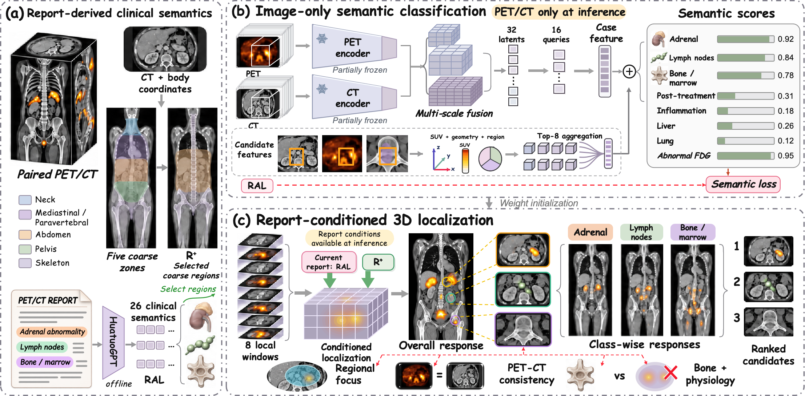
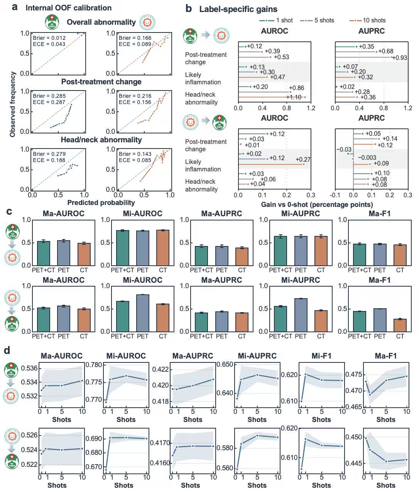

<div align="center">

# NB-PET

### Multi-label recognition and report-guided 3D localization in pediatric neuroblastoma PET/CT

**Routine report supervision · Image-only recognition · Report-conditioned localization**

[Overview](#overview) · [Method](#method) · [Evaluation](#evaluation) · [Results](#results) · [Getting started](#getting-started) · [中文](README.zh-CN.md)

</div>

## Overview

NB-PET uses routine Chinese PET/CT reports to derive clinical labels and coarse anatomical references. These structured signals supervise two research tasks in whole-body pediatric neuroblastoma PET/CT: **multi-label recognition from images alone** and **3D localization guided by the current examination's report**. The two tasks have different inference inputs and should be interpreted separately.

<p align="center">
  
</p>

*Manuscript Figure 1. The framework separates report-derived supervision, image-only recognition, and report-conditioned localization.*

## Method

### 1. Structure routine reports

Extract report-derived clinical labels and associate positive findings with coarse anatomical regions. These regions are weak spatial references, not manually drawn lesion masks.

### 2. Recognize findings from paired PET/CT

Learn PET/CT features for examination-level multi-label recognition. The current report is not an inference input for this task.

### 3. Localize report-specified findings

Condition the localization model on the structured labels and anatomical regions from the current examination. It produces overall and label-specific 3D response maps and ranks candidate regions for review alongside the source images.

| Task | Inference input | Output |
|---|---|---|
| Multi-label recognition | PET and CT volumes | Examination-level clinical label scores |
| Report-guided localization | PET and CT volumes, current report labels, and associated regions | Overall and label-specific 3D heatmaps; ranked candidates |

## Evaluation

### Study cohorts

| Cohort | Cases reported in the manuscript |
|---|---:|
| Beijing Friendship Hospital | 656 |
| Zhejiang University Children's Hospital | 280 |
| **Total** | **936** |

Each center evaluates 26 labels; cross-center recognition restricts evaluation to 25 shared labels. The site-specific pelvic definitions are not interchangeable.

### Evaluation settings

- **Recognition:** within-center validation and bidirectional cross-center evaluation, including zero-shot and few-shot adaptation.
- **Localization:** agreement between model responses and report-derived anatomical references. A reference-region hit is not evidence of overlap with a manually delineated lesion.
- **Comparability:** record the inference inputs, reference mask, grid, and aggregation unit with every result. Results from different protocols are kept separate.

See [data and evaluation](docs/data-and-evaluation.md) for label and scoring conventions.

## Results

### Cross-center recognition and few-shot adaptation

<p align="center">
  <a href="assets/figures/paper-fig4-cross-center.jpg"></a>
</p>

*Manuscript Figure 4. Calibration in panel a uses within-center held-out predictions; panels b–d show the two cross-center transfer directions. See the [panel descriptions](docs/paper-results.md#figure-4--cross-center-recognition-few-shot-adaptation-and-calibration).*

### Report-guided heatmap localization

NB-PET point estimates from manuscript Table 3:

| Cohort | Hit@1 ↑ | Hit@3 ↑ | WRMR ↑ | PULR ↓ | SUV-Enrichment ↑ | Components ↓ |
|---|---:|---:|---:|---:|---:|---:|
| Beijing | 0.9939 | 0.9954 | 0.9816 | 0.0093 | 6.7421 | 23.5078 |
| Zhejiang | 0.8286 | 0.8571 | 0.7603 | 0.0060 | 1.6884 | 40.0571 |

[Full Table 3: baselines, intervals, and P values](docs/paper-results.md#table-3--regional-agreement-and-spatial-distribution-of-report-guided-heatmaps). These metrics assess agreement with report-derived anatomical regions, not lesion-level accuracy.

## Getting started

### Run the synthetic evaluation

The bundled toy example demonstrates the effect of ties at the response threshold. It uses no patient data or model weights and does not reproduce a clinical result.

Use Python 3.10 or newer. The demonstration has no third-party dependencies; from the repository root:

```bash
python3 scripts/run_synthetic_evaluation.py
python3 -m unittest discover -s tests -v
```

The full NB-PET model and checkpoints are not included. See [release status](docs/release-status.md) for available materials.

## Data and model workflow

The research pipeline separates report structuring, image-only recognition, report-conditioned localization, and evaluation. For an implementation release, the preprocessing convention, label order, input contract, and evaluation rules must be versioned together. See [data and evaluation](docs/data-and-evaluation.md) for the intended documentation boundary.

## Repository structure

```text
NB-PET/
├── assets/figures/    # Manuscript figures and the initial schematic
├── configs/           # Synthetic demonstration inputs
├── docs/              # Data, evaluation, and release notes
├── scripts/           # Synthetic evaluation entry point
├── src/               # Data-free demonstration code
├── tests/             # Demonstration tests
└── .github/          # Checks and pull-request guidance
```

## Validation and contributions

The test suite checks selection budgets, empty references, and threshold ties using toy arrays. It does not validate clinical performance. See [contribution guidance](CONTRIBUTING.md) before adding material.

## Citation

The manuscript link, confirmed author list, and citation metadata will be added after release approval. No publication venue, DOI, or pretrained-model release is claimed here.

NB-PET is a research project and is not intended for clinical decision-making.
