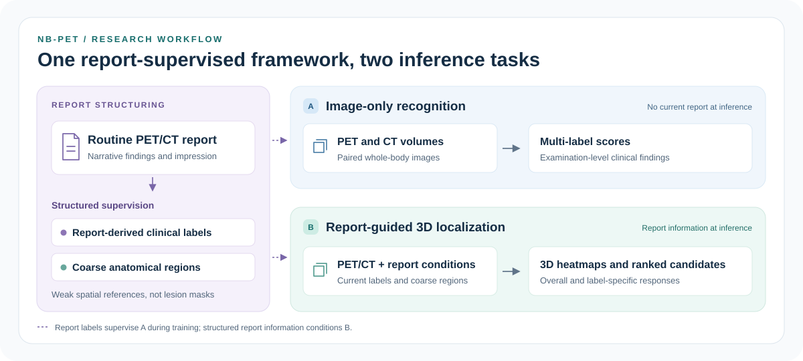

<div align="center">

# NB-PET

### 常规报告监督下儿童神经母细胞瘤 PET/CT 的多标签识别与报告引导三维定位

**常规报告监督 · 纯影像识别 · 报告条件定位**

[English README](README.md) · [数据与评价](docs/data-and-evaluation.md) · [发布状态](docs/release-status.md)

</div>

## 项目简介

NB-PET 从常规中文 PET/CT 报告提取临床标签及粗解剖区域，用于监督儿童神经母细胞瘤全身 PET/CT 的多标签识别与三维空间响应建模。识别与定位是两个独立任务，推理输入不同。



## 方法与评价

| 任务 | 推理输入 | 输出 |
|---|---|---|
| 多标签识别 | PET/CT 影像，不输入当前病例报告 | 检查级临床标签分数 |
| 报告引导定位 | PET/CT 影像、当前报告标签及对应解剖区域 | 总体和标签特异性三维热图、候选区域排序 |

论文队列包含北京友谊医院 656 例和浙江大学医学院附属儿童医院 280 例。两中心各评价 26 个标签，跨中心识别限定于 25 个共享标签。定位评价的参考由报告衍生，不能将区域命中率等同于逐病灶定位准确率。

## 快速开始

下面仅运行**合成评分示例**，无需安装额外依赖，无需医院数据：

```bash
python3 scripts/run_synthetic_evaluation.py
python3 -m unittest discover -s tests -v
```

当前草稿提供方法文档、示意图和指标演示，不提供可直接运行的完整 NB-PET 模型、权重、患者数据或论文全文。论文和引用链接在确认发布后补充。
