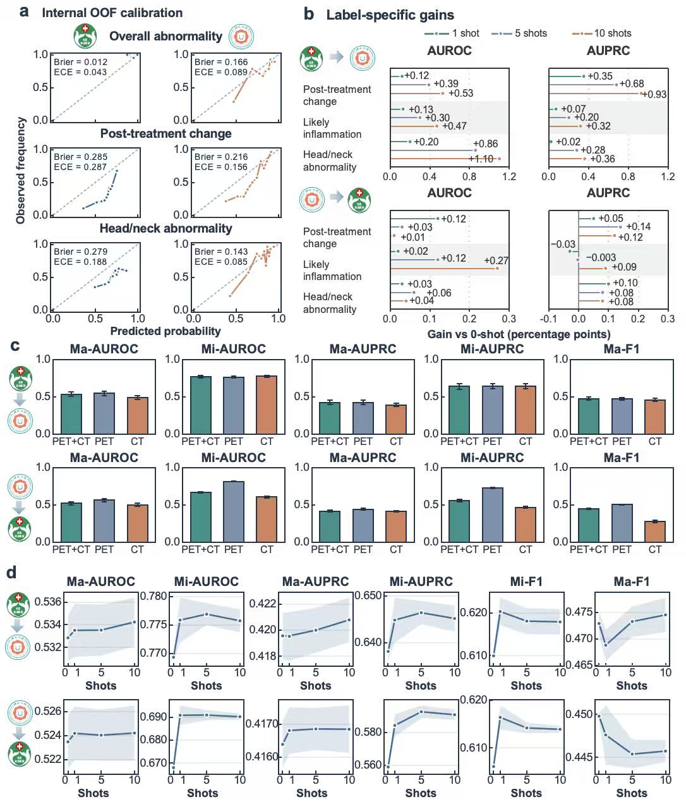

# NB-PET manuscript results

[English README](../README.md) · [中文首页](../README.zh-CN.md)

## Figure 4 · Cross-center recognition, few-shot adaptation, and calibration

**a.** Reliability curves use five-fold held-out predictions within each center. Brier scores and expected calibration error (ECE) are shown; the diagonal is perfect calibration. **b.** AUROC and AUPRC changes in percentage points relative to 0-shot for post-treatment change, likely inflammation, and head/neck abnormality. **c.** Cross-center recognition for paired PET/CT, PET only, and CT only. **d.** Overall cross-center results for 0, 1, 5, and 10 shots. Lines and shading show the mean and the reported 95% interval across 10 support-set draws. In panels b–d the top and bottom rows are Beijing → Zhejiang and Zhejiang → Beijing, respectively. Ma and Mi denote macro- and micro-averaging.

## Table 3 · Regional agreement and spatial distribution of report-guided heatmaps

Point estimates, bracketed intervals, and P values are transcribed from manuscript Table 3. Arrows indicate the direction used in the paper.

### Beijing Friendship Hospital

| Method | Hit@1 ↑ | Hit@3 ↑ | WRMR ↑ | PULR ↓ | SUV-Enrichment ↑ | Components ↓ |
| --- | ---: | ---: | ---: | ---: | ---: | ---: |
| **NB-PET (Ours)** | 0.9939[0.9866, 1.0000] | 0.9954[0.9895, 1.0000] | 0.9816[0.9743, 0.9889] | 0.0093[0.0044, 0.0143] | 6.7421[6.4873, 6.9969] | 23.5078[21.9129, 25.1027] |
| SUV-CC | 0.9924[0.9857, 0.9991] | 0.9954[0.9895, 1.0000] | 0.9802[0.9734, 0.9870] | 0.0115[0.0052, 0.0178] | 9.7192[9.5084, 9.9300] | 28.4625[26.6767, 30.2482] |
| Dinomaly | 0.9589[0.9443, 0.9735] | 0.9954[0.9895, 1.0000] | 0.8453[0.8350, 0.8557] | 0.0009[0.0004, 0.0014] | 2.2410[2.1691, 2.3129] | 315.4985[303.6622, 327.3348] |
| INP-Former | 0.9512[0.9332, 0.9693] | 0.9939[0.9852, 1.0000] | 0.8399[0.8301, 0.8498] | 0.0008[0.0004, 0.0013] | 1.9612[1.9039, 2.0184] | 347.0183[322.7899, 371.2467] |
| RealNet | 0.9101[0.8903, 0.9298] | 0.9954[0.9895, 1.0000] | 0.8069[0.7728, 0.8409] | 0.0027[0.0010, 0.0044] | 4.3607[4.1668, 4.5546] | 56.8548[50.4354, 63.2741] |
| P value | 0.3739 | 1.0000 | 0.0155 | 0.0211 | 8.976e-06 | 0.0018 |

### Zhejiang University Children's Hospital

| Method | Hit@1 ↑ | Hit@3 ↑ | WRMR ↑ | PULR ↓ | SUV-Enrichment ↑ | Components ↓ |
| --- | ---: | ---: | ---: | ---: | ---: | ---: |
| **NB-PET (Ours)** | 0.8286[0.7477, 0.9094] | 0.8571[0.8300, 0.8843] | 0.7603[0.7080, 0.8126] | 0.0060[0.0020, 0.0099] | 1.6884[0.6218, 2.7551] | 40.0571[0.0000, 113.2751] |
| SUV-CC | 0.8321[0.8069, 0.8574] | 0.8571[0.8258, 0.8885] | 0.8054[0.7892, 0.8216] | 0.1273[0.1021, 0.1525] | 7.7462[7.3332, 8.1592] | 47.9964[44.3373, 51.6555] |
| Dinomaly | 0.8500[0.8302, 0.8698] | 0.8643[0.8345, 0.8940] | 0.7663[0.7413, 0.7914] | 0.0091[0.0075, 0.0106] | 3.1199[2.8537, 3.3861] | 405.1071[380.8868, 429.3275] |
| INP-Former | 0.8321[0.8069, 0.8574] | 0.8607[0.8318, 0.8896] | 0.7629[0.7368, 0.7891] | 0.0085[0.0073, 0.0098] | 2.6919[2.2059, 3.1779] | 546.4536[475.1624, 617.7447] |
| RealNet | 0.8286[0.7949, 0.8622] | 0.8536[0.8081, 0.8990] | 0.7632[0.7430, 0.7835] | 0.0113[0.0058, 0.0168] | 3.4421[2.7606, 4.1237] | 80.2786[70.1069, 90.4502] |
| P value | 0.3883 | 0.1778 | 0.0290 | 0.1581 | 1.318e-04 | 0.7722 |

**Evaluation reference.** The top 2% of in-body voxels by response are selected and grouped into ranked 3D connected components. Hit@1 and Hit@3 assess whether any of the top one or top three components overlap the report-derived anatomical reference. WRMR is the fraction of in-body response within the reference, and PULR is the fraction in rule-based physiological high-uptake regions outside the reference. SUV-Enrichment uses the selected-voxel mean SUV relative to the valid in-body mean SUV; Components counts distinct high-response regions. NB-PET receives PET/CT, the current report labels, and the associated anatomical references. The reference is a coarse report-derived region, not a manually delineated lesion mask.
